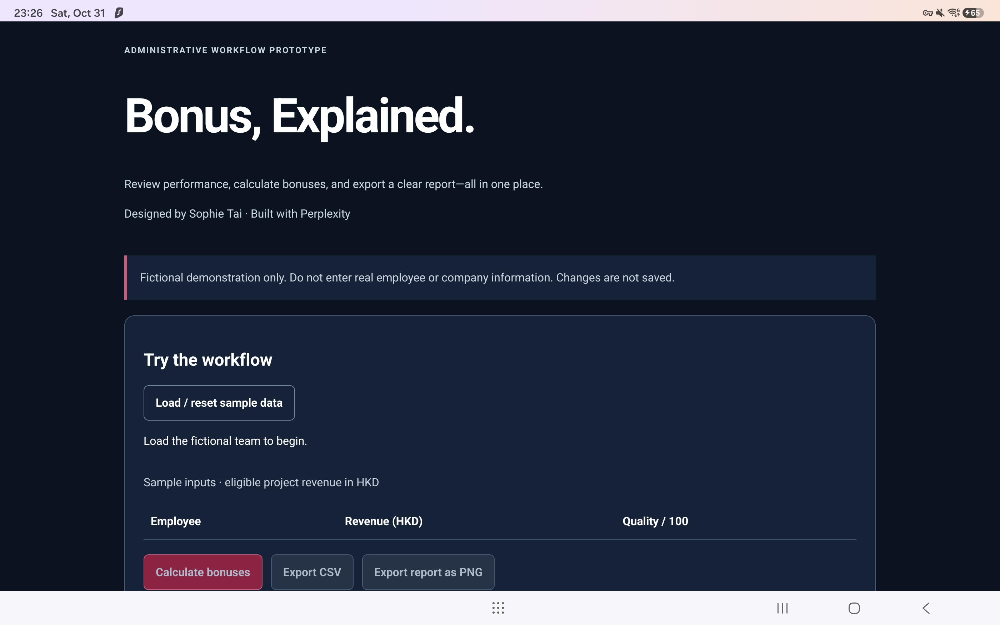
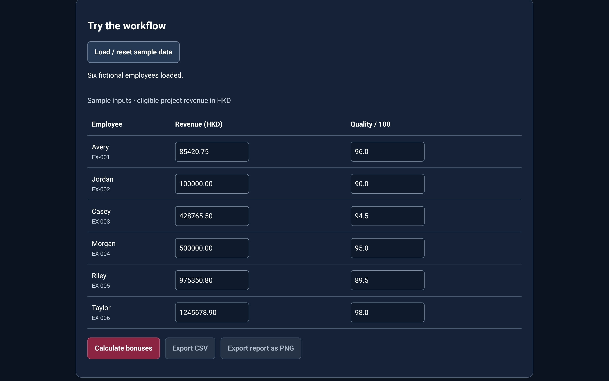

# Bonus Calculator Demo
### Bonus, Explained.

Designed by Sophie Tai · Built with Perplexity.

A core administrative workflow prototype: load fictional data, apply consistent rules, understand results, and export a report.

## Live demo

[Open Bonus, Explained.](https://bonus-calculator-demo.vercel.app/)

Use fictional sample data only. Changes are not saved.

## Interface walkthrough

### Opening screen

Opening screen introducing the fictional administrative workflow prototype.

### Sample data loaded

Sample data loaded for six fictional employees, ready for input adjustments and bonus calculation.

These are interface screenshots, not a full-page capture or an exported report. An exported report image is not included in this README.

## Verification status

Six automated Node.js tests passed in the initial review. Supplied calculator screenshots and an example exported report have been visually reviewed. This is not complete end-to-end browser verification. CSV spreadsheet compatibility, invalid-input browser behaviour, keyboard navigation, and broader browser checks remain pending.

## The problem
Rule-based administration involves checking inputs, calculating eligibility, explaining outcomes, and preparing reports. This prototype brings those steps into one small workflow rather than attempting to become a payroll product. No measured time savings or accuracy improvements are claimed.

## Try it locally
Serve the repository with a static server, for example `python -m http.server 8000`, then open `http://localhost:8000`. JavaScript modules require a server rather than directly opening the HTML file.

Load the sample team, edit revenue or quality, calculate, and export CSV or PNG. No package installation is required for the browser app. Inputs remain in memory; refreshing clears changes.

## Core workflow
- Six fictional employees with first names and sample IDs.
- Decimal eligible project revenue and quality scores.
- Validation, eligibility explanations, and group totals.
- CSV containing inputs, rates, bonuses, explanations, period, rule version, and total.
- PNG report generated using browser Canvas, not a device screenshot; all six records are included regardless of screen position.
- Editing inputs clears results and disables exports until recalculation.

## Fictional rules
Example Office Services · September 2026 · HKD · `demo-2.0`.

| Quality | Eligible revenue | Rate |
|---|---|---:|
| Below 90 | Any | 0% |
| At least 90 | Below HK$100,000.00 | 0% |
| At least 90 | HK$100,000.00 to below HK$500,000.00 | 8% |
| At least 90 | HK$500,000.00 or more | 12% |

The selected rate applies to all revenue, not just the amount above a threshold. Currency accepts two decimal places and is converted to integer cents. Each bonus is rounded to cents, half-cent ties up, before summing. These rates do not generate exact half-cent ties. Revenue is limited to HK$1,000,000,000.00 per record for bounded arithmetic, not as a payout cap. Quality accepts 0–100 with at most one decimal place. Enter amounts without commas or currency symbols.

Expected bonuses: Avery HK$0.00; Jordan HK$8,000.00; Casey HK$34,301.24; Morgan HK$60,000.00; Riley HK$0.00; Taylor HK$149,481.47. Expected total: HK$251,782.71; four eligible employees.

## Design and possible adaptations
Plain HTML, CSS, and modular JavaScript separate rules, calculations, and interaction. The interface uses navy, maroon accents, and white text; the report uses a white body with matching accents. Record text is rendered with DOM text properties. CSV quoting and formula-like text handling are included, but spreadsheet-specific checks remain necessary.

Possible adaptations—not implemented—include role-based eligibility, service-period adjustments, alternative qualification routes, approved exceptions, reporting periods, and custom report fields. Each needs separate requirements and verification.

## My role and development tools
I defined the administrative problem, confidentiality boundaries, workflow, sample-data requirements, and visual direction. I used Perplexity to help translate those requirements into code, draft documentation and test cases, and run automated checks.

The prototype uses HTML, CSS, and JavaScript, with GitHub for version control and Vercel for hosting. I reviewed the proposed scope and changes before publication. I do not claim every line was manually written. Perplexity ran the six automated tests and visually reviewed supplied screenshots and a sample report; full browser and export verification remains pending.

## Files and verification
`index.html` and `styles.css`: interface. `rules.js`: fictional configuration and samples. `calculator.js`: validation, integer-cent calculations, CSV. `app.js`: interaction and PNG rendering. `calculator.test.js`: tests. `package.json`: ES modules and test command.

With Node.js 20+ installed, run `npm test`. Six initial tests passed, covering sample outputs, totals, revenue and quality boundaries, rounding, invalid data, and basic CSV handling. This is not complete browser or security verification.

Manual verification checklist:
- [ ] Confirm six bonuses, four eligible employees, and HK$251,782.71 total through a complete browser run.
- [ ] Check empty, negative, malformed, excessive-precision, and excessive-value inputs.
- [ ] Confirm editing invalidates results and reset restores samples.
- [ ] Compare screen, CSV, and PNG results and decimal cents.
- [ ] Check full PNG content, readability, and download behaviour across intended browsers.
- [ ] Open CSV in the intended spreadsheet application.
- [ ] Check keyboard navigation, focus, announcements, narrow screens, and console errors.

Visual review of supplied images does not mark these full interaction checks complete.

## Ownership and reuse
This project is published for portfolio review and demonstration. No open-source licence is granted. Except where permitted by applicable law or GitHub's terms, permission is required to reproduce, redistribute, or adapt protected project materials. Please do not present this project as your own work.

Project attribution: Sophie Tai, built with Perplexity. This notice does not claim exclusive rights over unprotectable ideas, mathematical concepts, third-party materials, or material not eligible for copyright protection. Attribution and reuse notices do not technically prevent copying or override GitHub's public-repository permissions. The name has not been checked for trademark availability.

## Privacy and limitations
All rules and samples are fictional and independently authored for the demo. No private work-repository files were copied. Do not enter real employee data. The app has no database, persistence, analytics, external calculation API, authentication, approvals, or audit history. Hosting providers may retain normal access logs; downloaded reports remain on the visitor's device.

This is not payroll software, compensation advice, or a production-ready employee system. Tax and statutory entitlements are not calculated. Browser-visible rules are not confidential. PNG exports are fixed-layout reports for the six-record demo, not an unlimited reporting engine.
